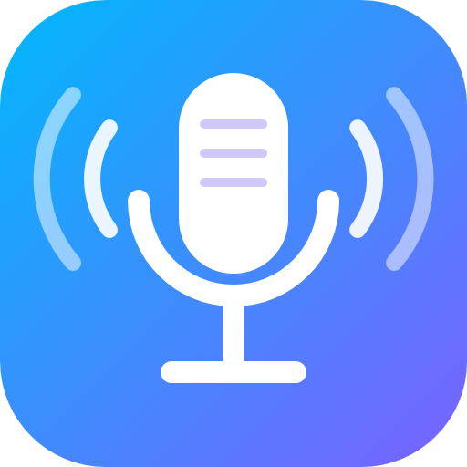
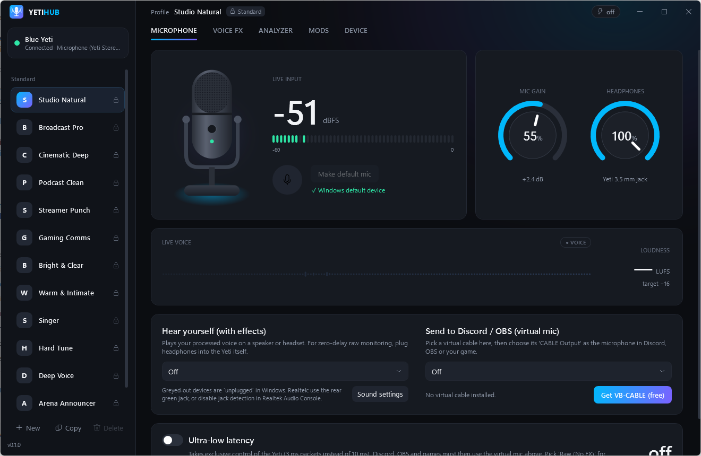
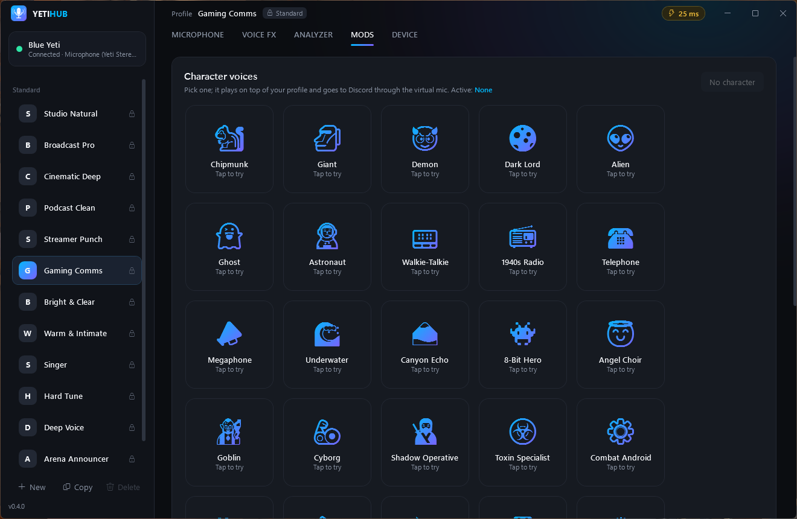
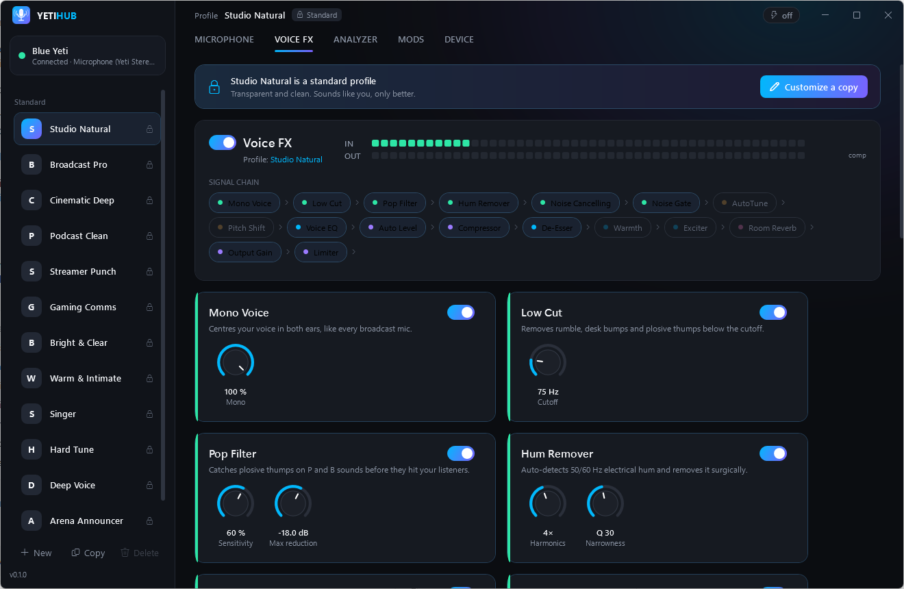
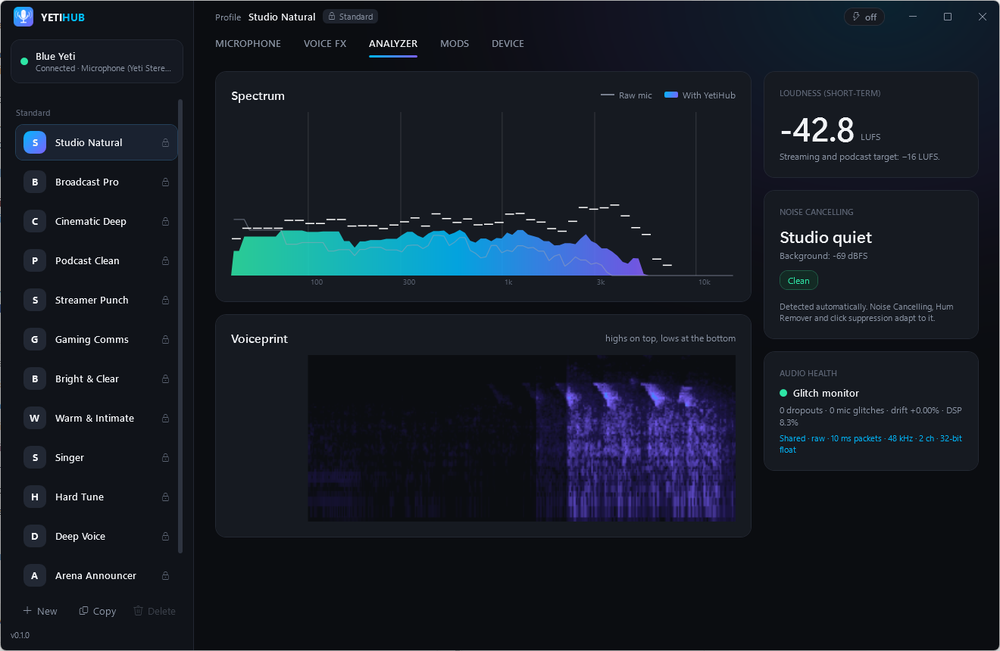

<p align="center">
  
</p>

<h1 align="center">YetiHub</h1>

<p align="center">
  <b>Free, open-source Blue Yeti software for Windows: noise cancelling, Voice FX, AutoTune and ultra-low latency.</b><br/>
  A modern alternative to Logitech G HUB and Blue VO!CE, built for the original Blue Yeti.
</p>

<p align="center">
  <a href="https://github.com/i-am-epic/YetiHub/releases/latest/download/YetiHub-win-Setup.exe"></a>
  <a href="https://github.com/i-am-epic/YetiHub/releases/latest"></a>
  <a href="https://github.com/i-am-epic/YetiHub/releases"></a>
  <a href="https://yetihub.vercel.app"></a>
  <a href="LICENSE"></a>
</p>

<p align="center">
  
</p>

> **Is your Blue Yeti missing from Logitech G HUB?** YetiHub detects it instantly and gives you more than G HUB did:
> professional voice processing, AI-style noise cancelling, live analyzers and one-click profiles, with no account and no telemetry.

## ⬇️ Download & install (2 minutes)

1. **Download** [`YetiHub-win-Setup.exe`](https://github.com/i-am-epic/YetiHub/releases/latest/download/YetiHub-win-Setup.exe) (Windows 10/11, 64-bit).
2. **Run it.** It installs for your user only (no admin needed) and opens straight away.
   Windows SmartScreen may say "unrecognized app" because the installer isn't code-signed yet: click **More info → Run anyway**.
3. **Plug in your Yeti.** YetiHub finds it automatically and shows its firmware and drivers.
4. **Pick a profile** in the sidebar, for example *Broadcast Pro* or *Gaming Comms*. That's it.
5. **To use it in Discord, OBS, Zoom or games**, see [Use your effects everywhere](#-use-your-effects-in-discord-obs-zoom-and-games).

YetiHub keeps itself up to date: new versions install with one click from the **Device** tab.
Prefer no installer? Grab `YetiHub-win-Portable.zip` from the [latest release](https://github.com/i-am-epic/YetiHub/releases/latest).

## ✨ Features

| | |
|---|---|
| 🎙️ **Instant Yeti detection** | USB IDs, firmware, Windows drivers and hot-plug, in milliseconds |
| 🔇 **Noise cancelling** | OM-LSA speech enhancement with MCRA noise tracking: learns your room while you talk, removes fan, hiss, hum and keyboard clicks, classifies the noise, and has voice guards so words aren't cut |
| 🎚️ **17-stage Voice FX** | Mono · Low Cut · Pop Filter · Hum Remover · Noise Cancelling · Noise Gate · AutoTune · Pitch Shift · Voice EQ · Auto Level · Compressor · De-Esser · Warmth · Exciter · Room Reverb · Output · Limiter |
| 🎵 **AutoTune & voice changer** | Real-time pitch correction (key, scale, retune speed), Hard Tune, Pitch Shift and Deep Voice |
| 🎭 **28 character voices** | Chipmunk, Demon, Dark Lord, Alien, Ghost, Astronaut, Walkie-Talkie, 8-Bit Hero, Cyborg and more, plus a **Tactical Agents** pack for team shooters (Shadow Operative, Toxin Specialist, Recon Drone, Command HQ…) in an animated one-click gallery |
| 📊 **Live analyzers** | Spectrum (raw vs processed), scrolling voiceprint spectrogram, live waveform, LUFS loudness meter |
| ⚡ **Ultra-low latency** | Custom WASAPI engine (IAudioClient3, MMCSS Pro Audio thread, adaptive drift resampling); ~20 ms mic-to-ear, with live measured latency and a glitch monitor |
| 🗂️ **Profiles** | 13 studio-tuned standard profiles (read-only) plus unlimited editable copies, saved as JSON |
| 🔌 **Virtual mic** | Send the processed voice to VB-CABLE/Voicemeeter for Discord, OBS, Zoom, Teams and games |
| 🧩 **Mods** | Drop-in DLL plugins with real-time audio processors ([write one](docs/MODS.md)) |
| 🔄 **Auto-update** | Delta updates from GitHub Releases |

<p align="center">
  
</p>

<p align="center">
  
  
</p>

## 🎛️ Standard profiles

Every standard profile is tuned for the Blue Yeti and verified by automated speech tests (no chopped words, about −16 LUFS).
They're read-only; press **Customize a copy** to tweak your own.

| Profile | Sounds like |
|---|---|
| **Studio Natural** | Transparent and clean. You, but better |
| **Broadcast Pro** | Big, polished radio voice |
| **Cinematic Deep** | Deep trailer voice with a touch of space |
| **Podcast Clean** | Smooth and consistent for long listening |
| **Streamer Punch** | Loud and crisp, cuts through game audio |
| **Gaming Comms** | Maximum clarity, keyboard and fan removed |
| **Bright & Clear** | Intelligible calls for Zoom and Teams |
| **Warm & Intimate** | Soft and velvety for late-night talk and ASMR |
| **Singer** | Gentle pitch correction with a vocal plate |
| **Hard Tune** | The robotic T-Pain effect |
| **Deep Voice** | Three semitones lower |
| **Arena Announcer** | Stadium hype voice |
| **Raw (No FX)** | The untouched Yeti, at the lowest latency |

## 🔌 Use your effects in Discord, OBS, Zoom and games

Windows doesn't let apps create microphones without a signed driver, so YetiHub uses the free, widely used VB-CABLE:

1. Install [VB-CABLE](https://vb-audio.com/Cable/) (free) and reboot if asked.
2. In YetiHub → **Microphone** → *Send to Discord / OBS*, choose **CABLE Input**.
3. In Discord / OBS / your game, set the microphone to **CABLE Output**.

Tip: turn **off** Discord's own noise suppression (Krisp) and "automatically determine input sensitivity" once YetiHub
handles noise. Doubling up is the most common cause of cut-off words.

## ❓ FAQ

**Does it work with Yeti Nano, Yeti X or Snowball?** The original Yeti is fully supported. Other Blue mics are detected
generically; add their USB IDs to [`KnownDevices.cs`](src/YetiHub.Core/KnownDevices.cs) and open a PR.

**How does Logitech's software work, and can YetiHub do the same?** See [docs/HARDWARE.md](docs/HARDWARE.md): what the Yeti exposes over USB, how G HUB injects Blue VO!CE into Windows' audio engine, and YetiHub's plan to do the same.

**Does it update the Yeti's firmware or drivers?** No. The Yeti runs on Microsoft's built-in USB audio drivers, and Logitech
never published a firmware tool for it. YetiHub shows what's installed and never writes to the device.

**Can it change the Yeti's polar pattern (cardioid/omni/stereo/figure-8)?** That's the physical knob on the back; it
isn't controllable over USB.

**The window is blank or white.** Turn on **Device → Compatibility graphics** (or set `YETIHUB_SOFTWARE_RENDER=1`).
This happens with some GPU drivers and remote-desktop sessions.

**Is it safe?** It's open source (MIT) and built by GitHub Actions from this repository. No account, no telemetry,
no network access except checking GitHub for updates.

## 🛠️ Build from source

Requires the [.NET 10 SDK](https://dotnet.microsoft.com/download).

```bash
dotnet build YetiHub.slnx
```

```bash
dotnet test YetiHub.slnx
```

```bash
dotnet run --project src/YetiHub.App
```

```
src/YetiHub.App                 WPF app: UI, live graphs, settings, updater
src/YetiHub.Core                Detection, low-latency WASAPI engine, DSP effects, profiles, mod host
src/YetiHub.Mods.Abstractions   Public mod API (semver; breaking change = major bump)
mods/YetiHub.Mods.RobotVoice    Sample mod (simplest example)
mods/YetiHub.Mods.CharacterVoices  Character Voice Pack + Tactical Agents Pack
tests/YetiHub.Core.Tests        Unit tests + speech-quality regression tests
docs/                           MODS.md, RELEASING.md, website (GitHub Pages)
```

Releasing: push a `vX.Y.Z` tag and GitHub Actions builds, tests, packages and publishes. See [docs/RELEASING.md](docs/RELEASING.md).

## 🗺️ Roadmap

- Native APO (Windows audio-engine plug-in) so effects reach every app without VB-CABLE, like G HUB's Blue VO!CE
- Neural noise suppression model (RNNoise/DeepFilterNet) as an optional stage, to remove other voices/TV, which no statistical canceller can
- Per-app automatic profiles and global hotkeys
- Code-signed installer (removes the SmartScreen warning)
- Yeti Nano / Yeti X / Yeti GX hardware IDs

## 📄 License

MIT. Not affiliated with Logitech or Blue Microphones. "Blue Yeti" and "G HUB" are trademarks of Logitech.
